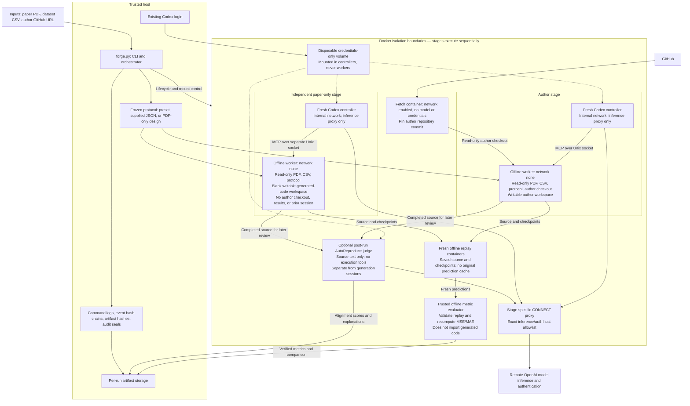

# Forge: Paper-to-Code Reproduction Benchmarking

Forge compares an author's implementation with an independent LLM implementation
generated from a research paper. Inputs are a **PDF path, dataset path, and author
GitHub URL**. Both implementations run in Docker against a frozen experiment
protocol. The pipeline retains code, checkpoints, results, and audit logs.

The current runtime supports regularly sampled numeric time-series forecasting
CSVs. See the [pipeline documentation](reproduction/README.md) for full details.

## Architecture



The orchestrator first freezes the protocol, then fetches and runs the author
implementation, and finally starts a separate paper-only generation session.
The PDF and CSV enter each worker through read-only input mounts. Workers have
no internet, login credentials, or Docker socket. The independent session cannot
access the author checkout, author results, or earlier session history. Remote
inference still requires the controller's allowlisted network connection; the
LLM itself is not hosted locally inside Docker.

The optional benchmark judge sees both implementations **after generation**.
Its findings are saved separately and are not fed back into the generated code.
Runtime isolation cannot establish what public code a model encountered during
its original training.

## Run an experiment

Requirements: running Docker, Python 3.9+, a non-root host user, and an existing
file-backed Codex ChatGPT login. Missing Docker images build automatically.

```bash
python3 forge.py preflight

python3 forge.py run \
  --paper papers/paper5/paper5.pdf \
  --dataset datasets/ETTh1.csv \
  --author-repo https://github.com/MAZiqing/FEDformer \
  --experiment paper5.1 \
  --benchmark-suite autoreproduce
```

Omit `--benchmark-suite autoreproduce` to run only the numerical reproduction
comparison. To benchmark an existing completed run without retraining:

```bash
python3 forge.py benchmark --run-dir PATH_TO_RUN
```

## Results and audit records

Successful pipeline runs also create a small, Git-trackable export under
`committed/<run-id>/` (with an evaluation suffix when included). It preserves
generated source, protocol, metrics, benchmark explanations, and provenance.
Large artifacts, author checkouts, and raw logs stay in ignored run archives.
Use `--no-export` to opt out, or export existing results:

```bash
python3 forge.py export --run-dir PATH_TO_RUN --evaluation-dir PATH_TO_EVALUATION
```

Exports have their own audit seal and reproduction instructions. They are not
automatically committed or pushed to Git.

`paper2.1` means experiment 1 of paper 2. Each directory under `runs/` is one
execution attempt; failed attempts are retained. Check `manifest.json` and
`RESULTS.md` for its completion status and benchmark outcome.

```text
papers/paper2/paper2.1/
├── runs/<run-id>/
│   ├── inputs/                       # PDF, CSV, frozen protocol
│   ├── author/repo/                  # Pinned author checkout
│   ├── author/run/                   # Author execution, replay, metrics
│   ├── paper-only/generated-code/    # Independent code and checkpoints
│   ├── paper-only/replay/            # Fresh inference outputs
│   ├── paper-only/results/           # Trusted metrics
│   ├── audit/                       # Commands and hash-chained events
│   ├── manifest.json
│   ├── benchmark.json
│   ├── RESULTS.md
│   └── audit-seal.json
└── evaluations/<run-id>/<evaluation-id>/
    ├── RESULTS.md
    ├── suite-results.json
    ├── audit/                       # Judge transcripts and commands
    ├── upstream/                    # Pinned evaluator source
    └── audit-seal.json
```

Verify an experiment or evaluation folder:

```bash
python3 forge.py verify --run-dir PATH_TO_RUN_OR_EVALUATION
```

Seals detect changes relative to the recorded hashes. Archive the printed seal
hash externally to detect replacement of the entire local seal.

## What the benchmark means

Forge's numerical comparison checks execution completion and whether generated
MSE and MAE fall within a configured 5% relative difference from the freshly
executed author reference. This is a Forge policy; similar metrics do not prove
equivalent architecture or faithful reproduction of every paper detail.

The optional integration invokes pinned upstream
[AutoReproduce evaluators](https://github.com/AI9Stars/AutoReproduce) for paper,
code, and mixed alignment, plus its performance-gap calculation. FITS is a custom
task using Forge's protocol and existing Codex login, so these results are not
official ReproduceBench leaderboard scores. Judge judgments, adaptations, source
commit, prompts, and responses are retained for review.
